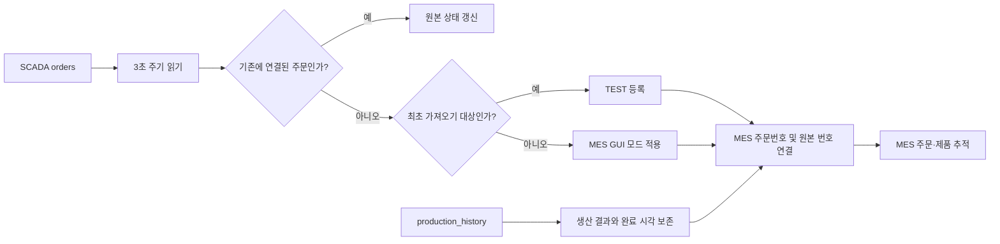

# SCADA 주문 데이터와 MES 연동

> TEAM 2 학습용 MES · 구현 기록 · 2026-09-28

## 개요

SCADA의 기존 주문을 MES 주문번호와 연결하고, 이후 신규 주문을 자동 등록하도록 구성했다. 공정테스트와 생산의 구분은 MES GUI에서 결정한다.



## 연결 구성

| 구분 | 구성 |
|---|---|
| SCADA 원본 서버 | `10.10.24.170:3306` |
| 원본 DB | `smart_factory` |
| 원본 주문 테이블 | `orders` |
| 제품 옵션 테이블 | `product_master` |
| 생산 결과 테이블 | `production_history` |
| MES DB | `opcua-manufacturing` |
| MES GUI | `http://10.10.24.174:8765` |
| 수집 주기 | 정상 처리 후 3초 간격 |
| 원본 접근 | 읽기 전용 |

원본 테이블의 실제 이름은 `order`가 아닌 `orders`이다. 접속 비밀번호와 접속 설정 파일은 이 문서에 포함하지 않는다.

## 이번 작업 결과

| 항목 | 결과 |
|---|---|
| 기존 SCADA 주문 | 104건 가져오기 완료 |
| 기존 주문의 저장 모드 | 전체 `TEST` |
| 원본 주문 상태 | 완료 103건, 진행 중 1건 (최초 가져오기 시점) |
| 원본 완료 제품 수량 | 223개 (최초 가져오기 시점) |
| 생산 결과 이력 | 108건 보존 |
| 신규 주문 수집 | GUI 실행 중 자동 확인·등록 |
| 중복 등록 | 원본 서버 식별자와 원본 주문번호로 방지 |

108건은 `production_history`에 실제 존재하는 결과 행 수다. 주문의 누적 완료 수량 223개와 다른 집계이므로 같은 수치로 해석하지 않는다.
기존 MES 기능 검증 주문은 별도로 유지한다. 최초 확인 시 GUI의 총 주문 110건은 SCADA 104건과 기존 검증 주문 6건의 합계다.

## 저장 모드 정책

1. 최초 가져오기에 포함된 원본 주문 104건은 모두 `TEST`로 등록한다.
2. 이후 새로 발견한 주문은 등록 시점의 MES GUI 선택에 따라 `TEST` 또는 `PRODUCTION`으로 저장한다.
3. 원본 SCADA의 상태보다 MES GUI의 저장 모드를 우선한다.
4. 이미 등록된 주문의 모드는 GUI를 전환해도 변경하지 않는다.
5. 같은 원본 주문은 모드가 달라져도 다시 생성하지 않는다.

현재 모드는 `mode.json`에서 읽는다. 모드는 저장 데이터 분류이며 PLC 운전 모드 변경 명령이 아니다.

## MES 주문번호와 시간

번호 구성:

```text
한국시간 날짜-시각 + 차종 + 시트 옵션 + 램프 옵션 + 원본 주문번호
20260927-165857-TRUCK-C-B-S104
```

- 기존 주문은 `start_time`을 사용한다. 시작 시각이 없으면 `order_time`을 사용한다.
- 시작 전 신규 주문은 주문 시각으로 번호를 할당한다. 생산 시작 후에도 이미 할당한 번호는 바꾸지 않는다.
- 원본 주문번호 `104`는 `S104` 접미사 및 연결 테이블에 보존한다.
- 제품별 추적번호에는 `-001`, `-002` 등의 순번을 붙인다.
- 원본 시각은 한국시간으로 해석하고 DB에서는 UTC로 보존한다. GUI는 `Asia/Seoul`로 표시한다.
- 실제 생산 시작 시각은 원본의 `start_time` 변경을 별도로 반영한다.

| 옵션 | MES 해석 |
|---|---|
| `VAN` | 밴, 시트 2개 |
| `TRUCK` | 트럭, 시트 1개 |
| 가운데 `C` | cocoabrown |
| 가운데 `B` | darkbrown |
| 마지막 `A` | 라운드 램프 |
| 마지막 `B` | 각진 램프 |

램프 해석은 사용자 지정 규칙을 따른다. 원본 `light_type`의 네모/세모 표기는 원본 JSON에 그대로 보존한다. 원본 `product_code`는 상품 코드이며, 확인되지 않은 PLC 프로그램 번호로 추정하지 않는다.

## 데이터 연결 구조

| 테이블 | 역할 |
|---|---|
| `mes_orders` | MES 주문번호, 제품 옵션, 수량, 저장 모드 |
| `mes_units` | 제품별 추적번호와 현재 MES 공정 상태 |
| `mes_external_orders` | 원본 주문번호와 MES 주문번호 연결, 원본 시각·상태 JSON |
| `mes_external_production` | 원본 생산 결과 ID, OK/NG, 완료 시각 |
| `mes_dispatch_queue` | MES 생산 대기 순서 및 재생산 시도 |
| `mes_scada_outbox` | 향후 SCADA에 전달할 큐 변경 기록 |

`mes_external_orders`는 `(source_name, source_order_id)`를 기본키로 사용한다. 주문 생성과 원본 번호 연결은 같은 트랜잭션으로 처리하여 재시작·재수집 시 중복을 막는다.
`mes_external_production`도 원본 결과 ID를 기본키에 포함하여 같은 생산 이력을 여러 번 저장하지 않는다.

## 과거 완료 주문 처리

- 원본 완료 수량에 따라 완료된 제품 추적 행을 등록한다.
- 완료된 과거 제품은 생산 대기열에 넣지 않는다.
- 과거 완료 수량을 현재 완료창고 재고에 자동 가산하지 않는다.
- 원본 완료 기록만으로 공정별 완료 시각, 승인자 또는 PDF를 만들어내지 않는다.
- 원본에서 진행 중인 제품은 공정 대응 대기 상태로 표시한다. 현재 공정을 임의로 추정하지 않는다.

원본 상태가 바뀌면 원본 정보를 갱신한다. 작업자가 이미 기록한 MES 공정은 덮어쓰지 않는다. 수기 공정 기록이 없는 가져오기 제품의 완료 상태는 원본 완료 수량에 맞춰 동기화한다.

## GUI 확인

**생산 주문** 화면에서 다음을 확인할 수 있다.

- 원본 DB 연결 상태와 연결 주문 수
- MES 주문번호와 원본 SCADA 주문번호
- 원본 주문 상태 및 완료 수량
- 한국시간 생산 시작 시각
- MES 생산 대기 순서

원본 104번을 확인하려면 주문 검색에 `S104`를 입력한다.

## 검증

- [x] 기존 주문 104건 전체 `TEST` 등록
- [x] 생산 결과 108건 보존
- [x] MES 주문번호 유일성 확인
- [x] 같은 원본을 다시 읽었을 때 추가 등록 0건
- [x] 신규 주문이 GUI의 `TEST` / `PRODUCTION` 선택을 따르는지 확인
- [x] GUI에서 원본 104번과 MES 주문번호 연결 확인
- [x] 자동 수집기 연결 상태 확인

신규 모드 검증은 모의 원본 입력과 생성 SQL 확인으로 수행했다. 원본 SCADA DB에 검증용 가짜 주문을 추가하지 않았다.

## 실행과 파일

GUI 시작은 `start.cmd`, 종료는 `stop.cmd`를 사용한다. 자동 주문 수집은 GUI 서버와 함께 시작하고 종료한다.

| 파일 | 용도 |
|---|---|
| `app.py` | GUI API와 데이터 표시 |
| `scada_sync.py` | 원본 주문·생산 이력 읽기 및 MES 등록 |
| `scada-source.json` | 원본 위치, 수집 설정, 최초 가져오기 주문 경계 |
| `scada-sync-status.json` | 최근 연결 상태와 수집 결과 |
| `schema.sql` | MES 및 원본 연결 테이블 정의 |
| `README.md` | 전체 실행·운영 안내 |
| `SCADA_PIPELINE.md` | 원본 연결 및 향후 큐 전송 계약 |

## 남은 연동 범위

현재 원본 SCADA DB는 읽기만 한다. MES 재생산 큐를 원본 SCADA 큐에 반영하는 쓰기와 ACK 처리는 아직 연결하지 않았으며, `mes_scada_outbox`에 전송 대기로 보관한다.
설비 신호와 제품 추적번호의 자동 대응 및 PLC 주문 전송은 별도 정의가 필요하다. 이번 작업은 SCADA 주문을 MES에 가져오고 원본 상태·생산 결과를 연결하는 범위다.
